###
--------------------------------------------------

  

###

  <a href="README.md">🌐 English</a> &nbsp;|&nbsp; <strong>Español</strong>

 

  <!-- LinkedIn badge -->
  
  &nbsp;
  <!-- Portfolio badge -->
  
  &nbsp;
  <!-- Email badge -->
  
  &nbsp;
  <!-- Visitors badge -->
  

###

# Hola 👋 Me llamo Jesús
**Ingeniero Informático | Inteligencia Artificial y Machine Learning**

Soy estudiante de último curso de Ingeniería Informática (especialidad Computación) en la Universidad de Huelva, enfocado en Inteligencia Artificial, Machine Learning y Sistemas Multiagente. Me gusta construir sistemas de ML de principio a fin: de la señal y los datos al modelo, y del modelo al dispositivo.

- 🎓 Estudiante de último curso — TFG **Cortex-AI** con **Matrícula de Honor** y **finalista de los IV Premios Sopra Steria** a los mejores TFG en IA de Andalucía
- 🌍 En Huelva, Andalucía, España
- ✉️ Escríbeme a jesus.calvente.zapata.24@gmail.com
- 🤝 Abierto a colaborar en proyectos interesantes y buscando mi primera oportunidad en Ciencia de Datos / ML
- ⚡ Creo que disfrutar del proceso importa tanto como alcanzar la meta

###

<h3 align="left">🚀 Proyectos destacados</h3>

- **[Cortex-AI](https://github.com/jcalvente083/Cortex-AI)** — Detección precoz del Parkinson a partir de la voz (mi TFG). De las grabaciones clínicas a una app móvil con modelos propios: ML clásico, ResNet sobre espectrogramas mel y Wav2Vec2, AUC de hasta 0,94, con explicabilidad SHAP/Grad-CAM y despliegue en una Raspberry Pi 5. *Python · PyTorch · scikit-learn · FastAPI · Docker*
- **[UAV: detección en el edge](https://github.com/jcalvente083/UAV)** — Software de a bordo para dron que detecta objetos con YOLOv8n en CPU y envía vídeo y telemetría a una estación de tierra. Arquitectura hexagonal y Docker multiarquitectura. *C++ · ONNX Runtime · Qt · MQTT*
- **[GVGenius](https://github.com/jcalvente083/GVGenius)** — Agentes inteligentes que juegan a videojuegos de GVGAI con IA clásica: planificación STRIPS, búsqueda A*, árboles de decisión y sistemas basados en reglas. *Java*
- **[Sudokode](https://github.com/jcalvente083/Sudokode)** — Resolutor de sudokus modelado como problema de satisfacción de restricciones (AC-3 + backtracking), validado sobre un dataset de 1.000.000 de tableros. *Java*

➡️ Más en mi **[portafolio](https://www.jcalvente083.qzz.io)**.

###

<h3 align="left">🛠 Lenguajes y herramientas</h3>

###

  
  
  
  
  
  
  
  
  
  
  
  
  
  
  
  
  
  
  
  
  
  
  

###

<h3 align="left">🔥 Mis estadísticas</h3>

###

  

###

  
  

###

<picture>
  <source media="(prefers-color-scheme: dark)" srcset="https://raw.githubusercontent.com/jcalvente083/jcalvente083/output/pacman-contribution-graph-dark.svg">
  <source media="(prefers-color-scheme: light)" srcset="https://raw.githubusercontent.com/jcalvente083/jcalvente083/output/pacman-contribution-graph.svg">
  
</picture>

###

<h3 align="left">📱 Contacto</h3>

###

  
  
  

###

--------------------------------------------------------------------------------------------------
