###
--------------------------------------------------

  

###

  <strong>🌐 English</strong> &nbsp;|&nbsp; <a href="README.es.md">Español</a>

 

  <!-- LinkedIn badge -->
  
  &nbsp;
  <!-- Portfolio badge -->
  
  &nbsp;
  <!-- Email badge -->
  
  &nbsp;
  <!-- Visitors badge -->
  

###

# Hi 👋 My name is Jesús
**Computer Science Engineer | Artificial Intelligence & Machine Learning**

I'm a final-year Computer Science Engineering student (Computing specialization) at the University of Huelva, focused on Artificial Intelligence, Machine Learning and Intelligent Agents. I like building ML systems end to end: from the raw signal and the data all the way to the model and its deployment on a device.

- 🎓 Final-year student — BSc thesis (TFG) **Cortex-AI** awarded **Honors (Matrícula de Honor)** and **finalist of the 4th Sopra Steria Awards** for the best AI theses in Andalusia
- 🌍 Based in Huelva, Andalusia, Spain
- ✉️ Reach me at jesus.calvente.zapata.24@gmail.com
- 🤝 Open to collaborating on interesting projects and looking for my first role in Data Science / ML
- ⚡ I believe enjoying the process matters as much as reaching the goal

###

<h3 align="left">🚀 Featured projects</h3>

- **[Cortex-AI](https://github.com/jcalvente083/Cortex-AI)** — Early Parkinson's detection from voice (my BSc thesis). From clinical recordings to a mobile app with my own models: classic ML, ResNet over mel-spectrograms and Wav2Vec2, AUC up to 0.94, with SHAP/Grad-CAM explainability and deployment on a Raspberry Pi 5. *Python · PyTorch · scikit-learn · FastAPI · Docker*
- **[UAV: detection on the edge](https://github.com/jcalvente083/UAV)** — On-board drone software that detects objects with YOLOv8n on CPU and streams video and telemetry to a ground station. Hexagonal architecture and multi-arch Docker. *C++ · ONNX Runtime · Qt · MQTT*
- **[GVGenius](https://github.com/jcalvente083/GVGenius)** — Intelligent agents that play GVGAI video games using classic AI: STRIPS planning, A* search, decision trees and rule-based systems. *Java*
- **[Sudokode](https://github.com/jcalvente083/Sudokode)** — Sudoku solver modeled as a constraint satisfaction problem (AC-3 + backtracking), validated on a dataset of 1,000,000 puzzles. *Java*

➡️ More on my **[portfolio](https://www.jcalvente083.qzz.io)**.

###

<h3 align="left">🛠 Languages and tools</h3>

###

  
  
  
  
  
  
  
  
  
  
  
  
  
  
  
  
  
  
  
  
  
  
  

###

<h3 align="left">🔥 My Stats</h3>

###

  

###

  
  

###

<picture>
  <source media="(prefers-color-scheme: dark)" srcset="https://raw.githubusercontent.com/jcalvente083/jcalvente083/output/pacman-contribution-graph-dark.svg">
  <source media="(prefers-color-scheme: light)" srcset="https://raw.githubusercontent.com/jcalvente083/jcalvente083/output/pacman-contribution-graph.svg">
  
</picture>

###

<h3 align="left">📱 Connect with me</h3>

###

  
  
  

###

--------------------------------------------------------------------------------------------------
